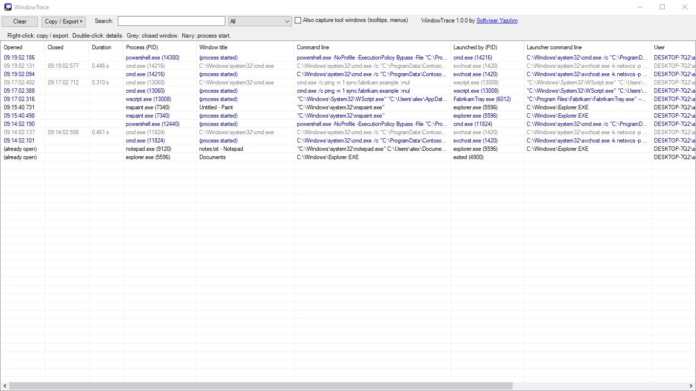
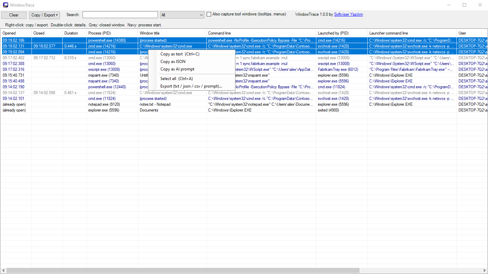

# WindowTrace

A window flashes on your screen and is gone before you can read its title. WindowTrace tells you what it
was: which process opened it, with what command line, under which user, and which program launched that
process in the first place.

It is a single small executable for Windows 10 and 11. It needs no installation, stores nothing and never
goes online.

## Download

Get `WindowTrace.exe` from the [Releases](https://github.com/softviser/windowtrace/releases/latest) page and
run it. The file is not code-signed, so SmartScreen may ask for confirmation the first time; the SHA-256
of each build is in its release notes.

## What it shows

Every row is either a window that appeared or a process that started:

| Column | Meaning |
| --- | --- |
| Opened, Closed, Duration | When the window appeared and disappeared, to the millisecond |
| Process (PID) | The process that owns the window, or the process that started |
| Window title, Window class | What the window called itself |
| Command line | The full command line of that process |
| Launched by (PID), Launcher command line | The parent process and its command line |
| User | The account the process runs under |
| Parent chain | The ancestors of the process, nearest first, for example `cmd.exe ← svchost.exe ← services.exe` |

Windows that have closed turn grey. Process starts are shown in navy. Windows that were already open when
WindowTrace started are listed with "(already open)".

The parent chain is usually what answers the question. A console window that flashes every five minutes and
traces back to `svchost.exe -k netsvcs -p -s Schedule` is a scheduled task; one that traces back to a tray
application is that application doing its background work.

## Using it

Start `WindowTrace.exe` and leave it open. When the mystery window shows up again, it is at the top of the list.

- Type in the search box to filter across every column, or pick Windows, Processes or Closed windows from
  the list next to it. "Closed windows" is the quickest way to find something that only flashed.
- Double-click a row to see all of its fields.
- Select one or more rows (Ctrl or Shift, Ctrl+A for all) and right-click to copy them as text, as JSON, or
  as a ready-made prompt you can paste into an AI assistant to ask what the process is and how to stop it.
- Export writes the same data to a txt, json or csv file. Copy and export use the selected rows, or
  everything currently visible when nothing is selected.

Command lines can contain passwords or tokens. Look over what you copied before pasting it anywhere.

### Run it as administrator for the full picture

Without administrator rights WindowTrace runs in limited mode: it finds new processes by polling four
times a second, so a process that lives for a few milliseconds can be missed, and command lines of
processes owned by other accounts or by the system are hidden.

Click "Restart as administrator" for an exact trace. WindowTrace then gets process starts from Windows
itself (`Win32_ProcessStartTrace`) and can read every process.

### Consoles and Windows Terminal

If Windows Terminal is your default terminal, a flashing `cmd` or `powershell` window is reported as a
`WindowsTerminal.exe` window launched by Explorer, which says nothing about the command that ran. Look at
the navy process rows with the same timestamp: they carry the actual command line and its launcher.

## Limits

- A parent process that exited before its child showed a window is reported as "exited". Naming it would
  need process tracing from boot; use Sysmon for that.
- A process that exits within a few milliseconds is still listed with its name and launcher when running as
  administrator, but its command line may read "(exited before it could be read)".
- Windows on other desktops and in other sessions (services, other logged-in users) are not visible.
- The list lives in memory. Export it before closing the program if you want to keep it.

## Building

There is nothing to install. The C# compiler that ships with Windows builds it:

    powershell -ExecutionPolicy Bypass -File build.ps1 -Test

This writes `dist\WindowTrace.exe` and runs the self-test, which opens a console window for a second and
checks that the window, its process and its launcher were recorded. The whole program is one file,
[src/WindowTrace.cs](src/WindowTrace.cs).

`tools\make-icon.ps1` redraws the icon and `tools\make-screenshots.ps1` retakes the screenshots from
`WindowTrace.exe --demo`, which fills the list with made-up rows instead of reading the machine.

## How it works

- `SetWinEventHook` reports every top-level window being shown, hidden or destroyed. No code is injected
  into other processes.
- `NtQueryInformationProcess` gives the command line and parent of the owning process, and the process
  token gives the user. Both are read the moment the window appears, because short-lived processes are
  gone a moment later.
- Process starts come from the WMI event `Win32_ProcessStartTrace` when elevated, and from comparing
  process lists otherwise.

## Privacy

WindowTrace makes no network connections and writes no files except the ones you export. See
[PRIVACY.md](PRIVACY.md).

## License

MIT, see [LICENSE](LICENSE). Made by [Softviser Yazılım](https://softviser.com.tr).
